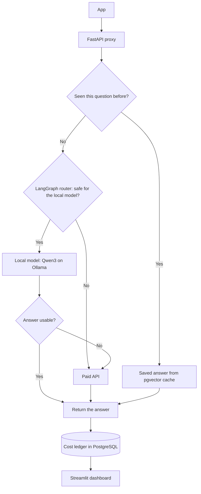

# AI FinOps Optimizer

Apps pay for every question they send to an AI API, even when the question is a repeat or simple enough for a free model. This project is a proxy that sits between an app and a paid API, answers what it safely can for free, and only pays for the rest.

Built with FastAPI, PostgreSQL with pgvector, LangGraph, Ollama and Streamlit. It runs on a MacBook Air with 8 GB of memory.

## Architecture

## How it works

- **Request:** an app sends its usual OpenAI-style request to the proxy. Only the API address changes.
- **Exact match:** if the same request was answered before, the saved answer comes straight back.
- **Similar match:** otherwise, the question is compared by meaning with earlier ones. Numbers and opposite words like "enable" and "disable" must also match, so "2024 revenue" never reuses an answer about 2025.
- **Routing:** new questions go through a set of rules. The local model gets tasks it can do from the text it is given, such as classifying, summarizing and extracting, plus math word problems. The paid API gets general knowledge questions, code and long requests.
- **Answer check:** a local answer that is empty, cut off or a refusal is thrown away and the question goes to the paid API. The same happens if the local model is down.
- **Saving:** the answer is returned and saved for next time.
- **Logging:** the route, tokens, response time and cost of every request are recorded.

## Results

I replayed 132 requests built from public datasets (Dolly, GSM8K, HumanEval and Quora Question Pairs) and compared two versions on the same requests.

| | First version | Current version |
|---|---|---|
| Local model | Llama 3.2 | Qwen3 |
| Local model handles | Anything that doesn't look hard | Tasks based on the given text, and math word problems |
| Requests kept off the paid API | 87% | 35% |
| API cost saved | 92% | **20%** |
| Local answers judged acceptable | 50% | **90%** |

The first version saved more, but half of its local answers were unacceptable, so I changed the routing rules and the local model. The current version gives up some savings for answers that can be relied on.

Typical response times in the current version:

| Route | Time |
|---|---|
| Saved answer | 3 ms |
| Paid API | 3.6 s |
| Local model | 8.3 s |

What to keep in mind:

- **Costs are simulated.** Calls ran on Groq but are priced at the list price of GPT-6.1 Sol. The baseline is $1.52 for all 132 requests.
- **Quality is graded by an AI judge,** not by people, on 22 and 29 answers. Each version sent different questions to its local model. On identical questions, Qwen3 scored 68% and Llama 3.2 scored 50%.
- **Savings depend on the traffic.** They rise and fall with how often questions repeat, and I chose the repeat rate for this test.
- **Matching by meaning added little.** Exact repeats always hit the cache (16 of 16), but reworded questions never did (0 of 16), and 1 of 8 look-alike questions matched wrongly.

## Dashboard

A one-page Streamlit dashboard presents these results for non-technical readers. It shows where requests and money go, compares the two versions and the two local models, and explains the limits of the test in plain language.

Run `make dashboard` and open http://localhost:8501.
